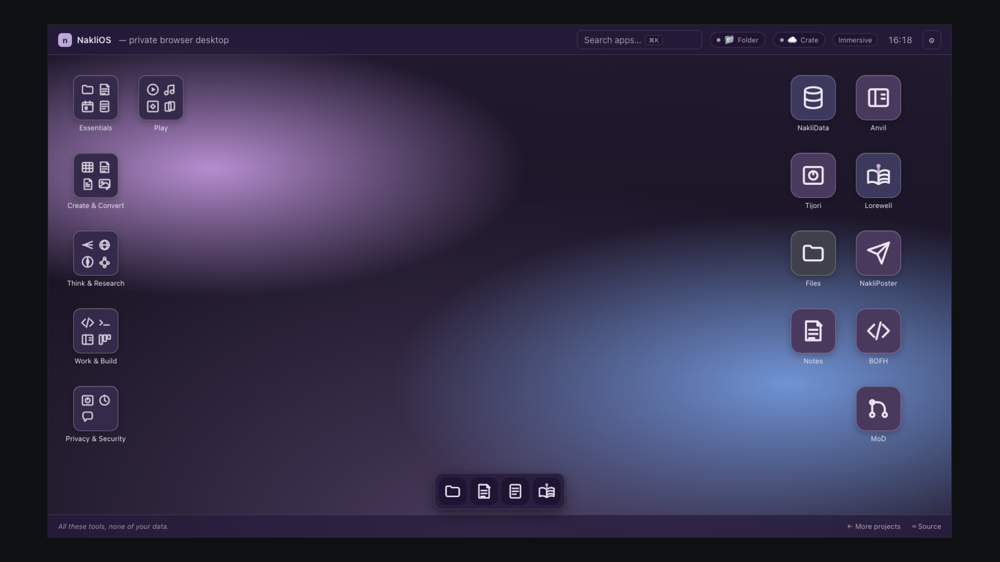

<h1 align="center">NakliOS</h1>

<p align="center"><strong>A browser desktop that brings your tools, files, coding agents and a voice assistant into one workspace.</strong></p>
<p align="center">Storage you choose. AI in your browser or on your own endpoint. No NakliOS account. No build step.</p>
<p align="center">
  <a href="https://github.com/NakliTechie/nakliOS/releases/latest"></a>
  <a href="LICENSE"></a>
  
</p>



## Install

| Platform | Start here |
| --- | --- |
| Desktop or mobile browser | Open [naklios.dev](https://naklios.dev/). The browser's install action can add it as an app. |
| macOS, Linux, Windows development | Install Node 24 and Git, then run the source checkout below. |

The first-run tour shows the desktop, the voice assistant and storage. Search opens with ⌘K or Ctrl+K.
For a local checkout:

```sh
git clone https://github.com/NakliTechie/nakliOS.git
cd nakliOS
node scripts/serve-coi.mjs
```

Open `http://127.0.0.1:8947/`; the server supplies the headers that Forge, Anvil, Dish and Pi need.
If a Books checkout sits beside NakliOS, the server serves it at `/Books/` for Lorewell's local embed
(`--books-root /path/to/Books` for another location).
No package installation or NakliOS account is required. Try Notes with Browser storage before connecting a folder, cloud storage, or AI.

## Why

Your notes, files, media and coding tasks occupy separate browser tabs with separate storage and AI settings.
NakliOS gives those tools one desktop, app windows, and one place to choose where data lives and which model runs.
Apps keep their standalone entrypoints.

## Choose where your work lives and which model runs

Apps offer storage according to their capabilities: Browser storage, a Folder you select, or encrypted Crate storage on your own Cloudflare R2.
Switching storage does not copy or delete existing data. Settings → App storage moves an app between a Folder and Crate, or revokes it.
Immersive mode opens compatible apps in windows; Basic mode opens other web apps in tabs. See the [`Experience mode policy`](docs/experience-modes.md).

Local tools need no model. The default model is LFM3 1.7B, which runs in your browser (about 1.4 GB on first use, then cached).
You can instead point Settings → AI at an OpenAI- or Anthropic-compatible endpoint with your own key; NakliOS holds the key and apps never see it.
Prompts and selected context go only to the destination you chose. [Storage and AI details](docs/desktop-reference.md) cover grants, credentials and downloads.

## Three coding agents and a terminal

Anvil, Dish and Pi read and write real files in your workspace and run shell commands, on the one model you chose in Settings → AI.
Anvil adds projects, tool traces, change previews, hooks, permission rules and run review with revert.
Dish hosts the pinned DeepSeek Harness Worker ([Dish reference](apps/dish/README.md)); Pi hosts pi-durable in a Worker. All three share one skills library.

Forge is the terminal over the same governed shell: pipes, sed, awk, loops, archives, structured-data commands and git porcelain.
The [Unix command reference](sys/rig/cli/cmds/README.md) lists supported flags and explicit refusals.
SQLite and Python use Kiln's optional Pyodide runtime. Stop cancels pending work; an operation already accepted can finish.

## Talk to your desktop

The 🎙 button starts a voice assistant on LFM3-Omni-2B, running in your browser with no server. It loads its 2.7 GB model only after you agree.
It sets timers and reminders, reads and adds calendar events, keeps Notes lists, looks up weather and Wikipedia, calculates, plays music from your own files, and opens apps.
It says plainly what it cannot do (calls, email, smart home). Every panel action is also an `assistant.*` host command, so agents can drive it.

## Commands

Run these in Forge after opening a workspace:

```sh
help                                    # list commands, flags, and unavailable capabilities
pwd                                     # show the workspace directory
ls                                      # list its contents
for n in one two; do echo "$n"; done    # run a bounded shell loop
git status                              # inspect an initialized workspace repository
agent "Summarize this project"          # run the coding agent on the model chosen in Settings → AI
```

Anvil exposes the same governed shell through its agent tool; [llms.txt](llms.txt) points coding agents to the contracts.
Settings → Apps → Add app from manifest installs your own app; the [app standard](docs/third-party-apps-v1.md) covers isolation and consent.

## Verify it yourself

From the repository root with Node 24:

```sh
node --experimental-vm-modules scripts/test-unix-portability.mjs c3553134571d1d601bfdbf857f6b3df138a6bf4f
node scripts/test-anvil-unix-integration.mjs
node scripts/test-pi-core.mjs
node sys/voice/test/voice.test.mjs
node scripts/test-sqlite-browser.mjs
node scripts/test-kiln-network-denial-browser.mjs
```

The browser checks need Chrome and network access for pinned Pyodide assets; failures and incomplete reports fail the gate.
`test-pi-core.mjs` needs `npm ci --prefix scripts/pi` first. The [full CI workflow](.github/workflows/test.yml) covers the wider desktop.
The voice test checks the assistant's tools and model adapter with a stand-in model; the model itself is checked live in a real browser, not in CI.

## License

MIT. See [LICENSE](LICENSE); vendored dependencies retain their own licenses and provenance files.

[Rig design](sys/rig/RIG-VISION-AND-ROADMAP.md) · [Desktop reference](docs/desktop-reference.md) · [App contract](docs/app-contract.md) · [Changelog](CHANGELOG.md) · [llms.txt](llms.txt)
